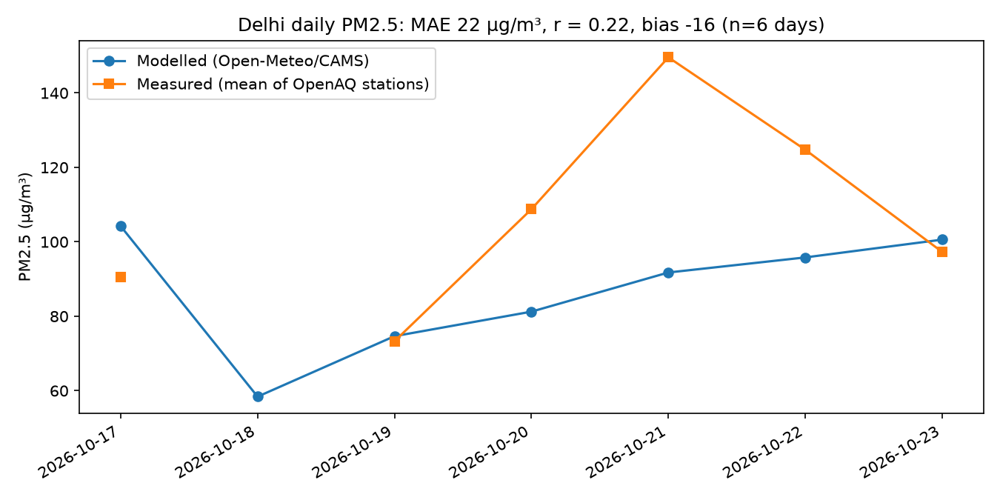
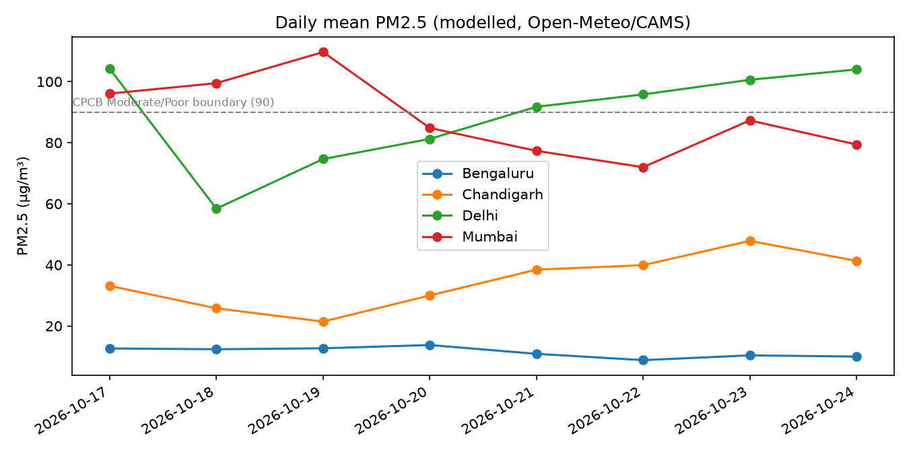

# pm2.5-check: Delhi air quality, modelled vs measured


How close is modelled PM2.5 (Open-Meteo / CAMS) to measured PM2.5 (OpenAQ stations),
and how do Delhi, Chandigarh, Mumbai and Bengaluru compare on India's CPCB AQI categories?

## Status
All parts are done and tested (`pytest -q`). Model-vs-measured covers Delhi only, using five stations.

## Run
Needs Python 3.12+ and a free OpenAQ API key (create an account at https://explore.openaq.org and copy the key from your settings).
The tests and the Open-Meteo parts need no key; only the Delhi measured data does.

```
git clone https://github.com/MRBOHNES/pm2.5-check.git && cd pm2.5-check
python -m venv .venv && .venv/bin/pip install -r requirements.txt
cp .env.example .env          # then edit .env and set OPENAQ_API_KEY=<your key>
.venv/bin/pytest -q                         # 48 tests, no network or key needed
.venv/bin/python -m app.charts              # fetches live data, writes output/*.png
.venv/bin/uvicorn app.main:app              # then open http://127.0.0.1:8000/docs
```
Endpoints: `/summary/delhi`, `/compare?cities=delhi,mumbai`, `/delhi/model-vs-measured`.
`.env` is gitignored. Put the key only in `.env`, never in `.env.example`.
The code asks for the last 7 days, so your numbers will differ from the findings below, which are for 17-23 Oct 2026.

## Docker
```
docker build -t pm25-check .
docker run -p 8000:8000 --env-file .env pm25-check
```

## CI
GitHub Actions runs `pytest -q` on every push and pull request (Python 3.12 and 3.14): `.github/workflows/tests.yml`.

## Flow
```
Open-Meteo (1 call, 4 cities) + OpenAQ (5 Delhi stations, concurrent) -> pydantic models -> DataFrame (Asia/Kolkata)
  -> clean (dedupe, bad values -> NaN) -> daily mean (>=18 valid hours)
  -> CPCB category (np.select) -> charts / API
```

## Decisions
- One shared `httpx.AsyncClient`; retry on 429, 5xx, timeouts; exponential backoff with jitter;
  `Retry-After` honoured; other 4xx fail immediately. Timeout maps to HTTP 504, other upstream failure to 502.
- Open-Meteo returns a bare list in request order with no city label, so cities are matched by position.
- Open-Meteo snaps coordinates to its model grid (Delhi 28.6139 -> 28.6), so it is a grid-cell estimate, not a point reading.
- No interpolation across gaps. A daily mean needs 18+ valid hours.
- AQI edge handling: bands use inclusive upper bounds, so 30 is Good and 30.5 is Satisfactory.

## Findings (17-23 Oct 2026)
**Delhi, modelled vs measured** (daily means, measured = mean of 5 OpenAQ stations):



1. **The model tracks Delhi only loosely.** Over the 6 days with valid data, MAE is 22 ug/m3, Pearson r is 0.22
   and bias is -16 ug/m3 (the model reads lower than the stations). With 6 points, r is a weak signal.
2. **The model misses the pollution peak.** On 21 Oct stations averaged 149.6 ug/m3 (Very Poor) while the model said
   91.8 (Poor); on 22 Oct it was 124.7 measured vs 95.8 modelled. The model agreed closely on 19 Oct (74.7 vs 73.3)
   and 23 Oct (100.6 vs 97.3). A ~45 km grid cell smooths out local peaks that point stations record.
3. **City comparison (modelled):** Delhi mean 88.8 ug/m3 (5 of 8 days Poor), Mumbai 88.3, Chandigarh 34.7,
   Bengaluru 11.4 (Good on all 8 days). Delhi and Mumbai have nearly the same mean with opposite trends.



## Limitations
- Six comparable days is too few for firm conclusions about model accuracy or any season.
- 18 Oct has no measured value: every station reported only 14 hours that day, below the 18-hour rule.
  23 Oct data ends at 21:00 IST, and stations with fewer than 18 valid hours that day are excluded.
- Five hand-picked stations (R K Puram, Punjabi Bagh, Pusa, Mandir Marg, Anand Vihar), not a full network.
  Older sensor ids on the same stations return no data, so live sensor ids are pinned.
- Modelled values are one grid cell; stations are points. Part of the gap is that mismatch, not model error.
- Modelled window includes forecast hours for the current day.
- Category bands confirmed from secondary sources, not the official CPCB document.
  CPCB's official label for 61-90 is "Moderately polluted".

## Next steps
Cover Chandigarh, Mumbai and Bengaluru with measured stations, use a longer window (a month or a season),
and check the bands against the official CPCB document.

CPCB National AQI: https://cpcb.nic.in/national-air-quality-index/
