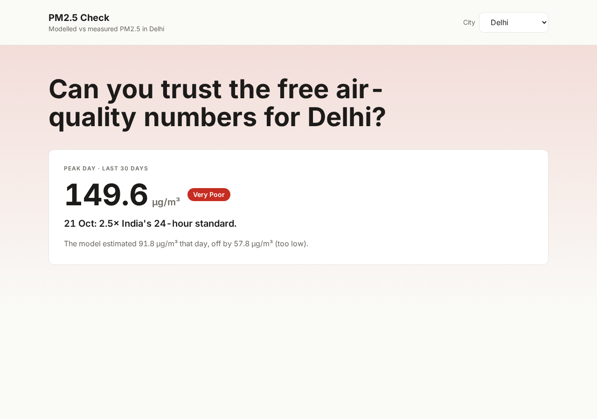
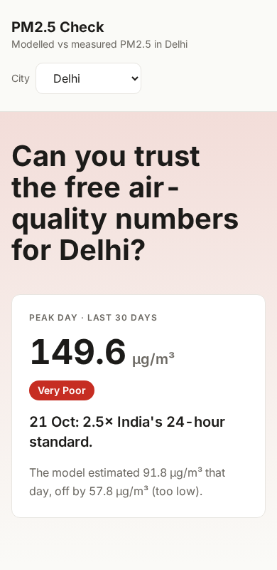
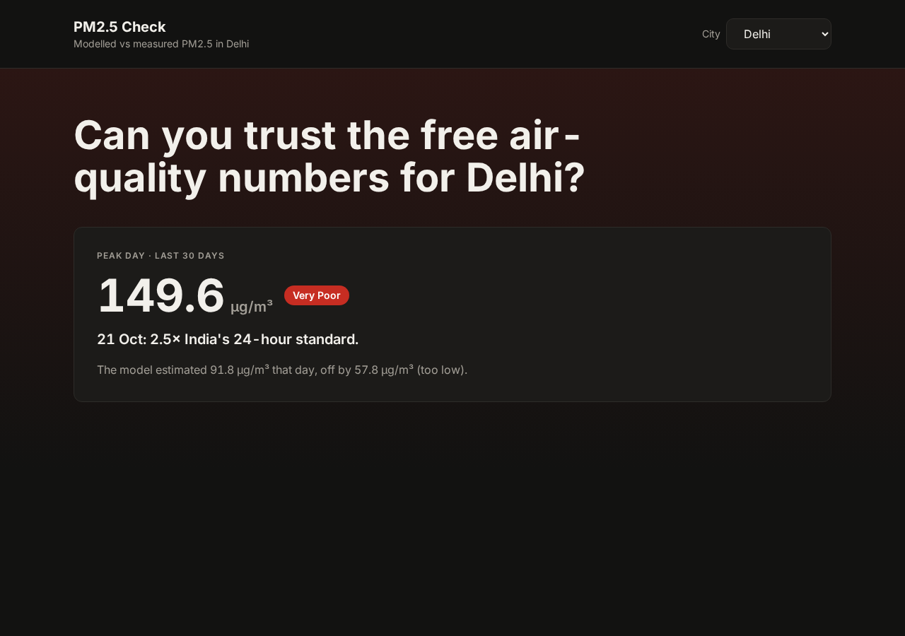
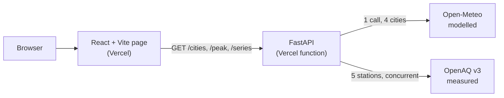

# PM2.5 Check: can you trust the free air-quality numbers for Delhi?

[](https://github.com/MRBOHNES/pm2.5-check/actions/workflows/ci.yml)
[](https://github.com/MRBOHNES/pm2.5-check/actions/workflows/deploy.yml)

Compares **modelled** PM2.5 (Open-Meteo, CAMS model) with **measured** PM2.5 (OpenAQ stations in Delhi), finds the
worst day, and bins days into India's CPCB air-quality categories.

**Live:** [pm2-5-check.vercel.app](https://pm2-5-check.vercel.app) (the page) and
[pm2-5-check-api.vercel.app](https://pm2-5-check-api.vercel.app/docs) (the API, with interactive docs at `/docs`).
The API sleeps when idle on the free plan, so the first request after a pause can take a few seconds.



<p>
  
  
</p>

## What it shows
1. **Peak day** (last 30 days): highest daily PM2.5, its CPCB category, how many times India's 24-hour standard
   it was, and how far the model was off that day.
2. **Model vs measured chart** with the peak day shaded, the 60 µg/m³ standard, and MAE / correlation / bias.
3. **CPCB category cards**: days spent in each of the six categories; the latest and the peak day's category are marked.
4. **Limitations** with links to every source.

Measured values exist for Delhi only (five stations). Other cities fall back to modelled values and say so.

## Findings (last 30 days to 25 Oct 2026, Delhi)
- **The model gets the shape right but misses the extremes.** Over 26 comparable days: MAE **17.0 µg/m³**, correlation
  **r = 0.72**, average bias +3.3 µg/m³.
- **The worst day was 21 Oct: 149.6 µg/m³ measured (Very Poor, 2.5x the standard) vs 91.8 modelled**, off by 57.8. A
  ~45 km grid cell smooths out local peaks that point stations record. 21 Oct is also the only outlier day.
- **Delhi was above India's 24-hour standard (60 µg/m³) on 17 of the 26 days with station data.**

Numbers come from a live run on 26 Oct 2026 and change daily. 26 of 30 days have station data (see Limitations).

## How it works

Hourly values become IST daily means (a day needs 18+ valid hours), modelled and measured are joined on the date, and
NumPy/pandas compute the CPCB category, MAE, correlation and the peak day. The data rules, module map and the reasons
behind each choice are in [`docs/ARCHITECTURE.md`](docs/ARCHITECTURE.md).

## Run locally
Needs Python 3.12+, Node 22+, and a free [OpenAQ API key](https://explore.openaq.org) (only the Delhi measured
data needs it; the tests need no key and no network).

```bash
git clone https://github.com/MRBOHNES/pm2.5-check.git && cd pm2.5-check

# backend
python -m venv .venv && .venv/bin/pip install -r requirements-dev.txt
cp .env.example .env                  # set OPENAQ_API_KEY=<your key>
.venv/bin/uvicorn app.main:app        # http://127.0.0.1:8000/docs

# frontend (second terminal)
cd frontend && cp .env.example .env.local && npm ci && npm run dev    # http://localhost:5173
```

Tests and checks (the same ones CI runs):
```bash
.venv/bin/ruff check . && .venv/bin/ruff format --check .
.venv/bin/pytest -q --cov=app --cov-fail-under=80      # 74 tests, ~85% coverage
cd frontend && npm run lint && npm run typecheck && npm test -- --run && npm run build   # 25 tests
```
`.env` is gitignored: the key lives only there (and in Vercel's settings), never in `.env.example`.

**API:** `GET /peak?city=Delhi&days=30`, `GET /series?city=Delhi&days=30`, `GET /cities`, `GET /health`,
plus `/summary/{city}`, `/compare?cities=delhi,mumbai`, `/delhi/model-vs-measured`.
`python -m app.charts` writes two PNG charts to `output/`.

**Docker** is for local runs and the CI check only; Vercel does not run the container:
```bash
docker build -t pm25-check . && docker run -p 8000:8000 --env-file .env pm25-check
```

## Deployment
Two Vercel projects from this one repo, shipped only by GitHub Actions after CI passes on `main`, then smoke-tested.
Vercel's own Git production deploys are off, and pull requests still get preview deployments. The one-time setup,
secrets list, how to check a deployment, rollback and troubleshooting are in [`docs/DEPLOY.md`](docs/DEPLOY.md).

## Docs
| Doc | Read it for |
|---|---|
| [`docs/ARCHITECTURE.md`](docs/ARCHITECTURE.md) | Data flow, module map, endpoints, data rules, decisions and trade-offs |
| [`docs/DEPLOY.md`](docs/DEPLOY.md) | Vercel and GitHub setup, secrets, checking a deployment, rollback, troubleshooting |
| [`docs/BUG_JOURNAL.md`](docs/BUG_JOURNAL.md) | Real bugs: symptom, cause, fix, lesson |
| [`docs/INTERVIEW_QA.md`](docs/INTERVIEW_QA.md) | Short answers about the code |

## Limitations
- **Modelled is not measured.** Open-Meteo gives CAMS model values on a ~45 km grid cell (it snaps coordinates to that
  grid); stations read at a point. Part of the gap is that mismatch, not model error.
- **Five hand-picked Delhi stations** (R K Puram, Punjabi Bagh, Pusa, Mandir Marg, Anand Vihar), not a full network.
  Other cities have no station data here.
- **Station feeds lag.** The latest days often have too few readings (daily means need 18 hours), so the last 1-2 days
  usually show modelled values only.
- **Thirty days** is too few to say how the model behaves across seasons.
- **Colours.** Category names and PM2.5 bands follow CPCB; the colours are adjusted for text contrast (all pass WCAG AA)
  and I could not check them against CPCB's official scale. CPCB's official label for 61-90 is "Moderately polluted";
  this app says "Moderate".
- 60 µg/m³ is the 24-hour PM2.5 limit in India's 2009 national standards. I did not check for later revisions.

## What I'd add next
Station data for more cities, a longer window (a season), a city comparison chart, an outlier table, Dependabot,
preview-URL comments on pull requests, structured request logs, and a multi-stage non-root Docker image.

## Sources
- Open-Meteo Air Quality API: https://open-meteo.com/en/docs/air-quality-api
- OpenAQ API: https://docs.openaq.org
- CPCB National AQI: https://cpcb.nic.in/national-air-quality-index/
- India's 2009 air quality standards (CPCB notification B-29016/20/90/PCI-L, 18 Nov 2009):
  https://leap.unep.org/akn/in/act/2009/b-29016-20-90-pci-l/eng@2009-11-18
