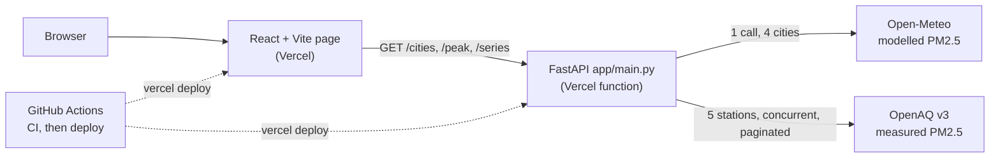

# PM2.5 Check architecture

How the app works and why it is built this way. For running it see the [README](../README.md); for deploying see
[`DEPLOY.md`](DEPLOY.md).

## Overview

The question the page answers: how close is free modelled PM2.5 (Open-Meteo, the CAMS model) to real station
measurements (OpenAQ) in Delhi, and which CPCB category does each day fall into?

## What happens on a page load

1. The page calls `GET /cities` (for the picker), then `GET /peak` and `GET /series` for the chosen city.
2. For Delhi the API fetches Open-Meteo and the five OpenAQ stations **concurrently**; other cities fetch Open-Meteo only.
   The results go through a best-effort in-process cache so `/peak` and `/series` share one upstream call each.
3. Hourly values become IST daily means (`cleaning.py`), modelled and measured are joined on the date, and `analysis.py`
   computes the peak day, MAE, correlation, category counts and the latest day.
4. Today is dropped: the day is in progress (and the modelled series includes forecast hours).

## Module map

| Path | Role |
|---|---|
| `app/client.py` | Async `httpx` client: timeout, retry with backoff and jitter, `Retry-After`, concurrency cap; Open-Meteo and OpenAQ fetchers |
| `app/models.py` | Pydantic models for both API responses, built from the saved responses in `samples/` |
| `app/cleaning.py` | Hourly frames to IST, dedupe, bad values to NaN, daily means (`modelled_daily`, `measured_daily`) |
| `app/analysis.py` | CPCB category (`np.select`), MAE, Pearson r, z-score outliers, peak day, category counts, latest day |
| `app/cache.py` | `TTLCache`: 10-minute cache that shares one in-flight fetch between concurrent callers |
| `app/main.py` | FastAPI app, CORS from `ALLOWED_ORIGINS`, endpoints, error mapping |
| `app/charts.py` | Two matplotlib charts written to `output/` (a separate command, not used by the API) |
| `frontend/src/api.ts`, `useAsync.ts` | Typed API client with a timeout; a hook that runs a request per key and cancels the previous one |
| `frontend/src/components/` | `PeakCard`, `ModelVsMeasuredChart`, `StatsPanel`, `CategoryCards`, `Limitations`, `Skeleton`, `ErrorCard` |
| `scripts/` | `smoke_backend.sh`, `smoke_frontend.sh`, `check_bundle.sh`: the deploy checks, runnable by hand |

## Endpoints

| Endpoint | Returns |
|---|---|
| `GET /peak?city=&days=` | The peak day: value, category, ratio to the 60 µg/m³ standard, modelled vs measured that day, and the source (`measured` or `modelled`) |
| `GET /series?city=&days=` | Daily modelled and measured values, MAE/correlation/bias, category counts, the latest day |
| `GET /cities` | Supported cities and whether they have measured data |
| `GET /health` | Liveness: status, deployed commit, time. Calls no upstream |
| `GET /summary/{city}`, `/compare?cities=`, `/delhi/model-vs-measured` | Earlier endpoints (modelled summary, city comparison, Delhi model vs measured), unchanged and still tested |

`days` is limited to 1-92 because that is Open-Meteo's `past_days` maximum.

## Data rules

- Open-Meteo values are labelled IST. OpenAQ hours arrive in UTC and are converted with `tz_convert("Asia/Kolkata")`, then
  grouped by IST calendar day. A reading at 18:00Z (23:30 IST) belongs to that IST day; 18:30Z (00:00 IST) to the next.
- Duplicate (station, timestamp) rows are dropped. Negative values and values above 1000 µg/m³ become NaN.
- An OpenAQ hour with under 75% coverage becomes NaN. A daily mean needs at least 18 valid hours.
- Gaps are never interpolated: filling them would invent data.
- Daily measured values are the mean of per-station daily means.
- CPCB bands use inclusive upper bounds (30 is Good, 30.5 is Satisfactory).

## Decisions and trade-offs

**Retry design.** Retry on 429, 5xx, timeouts and connection errors, up to 4 attempts, with exponential backoff
(`min(8 s, 0.5 s * 2^attempt)`) plus up to 25% jitter, and `Retry-After` (or OpenAQ's `x-ratelimit-reset`) honoured. Other
4xx fail at once, because retrying a bad request cannot help. A timeout becomes HTTP 504; any other upstream failure 502.

**Models from real responses.** The Pydantic models were written from saved real responses, not from the docs, so a
schema change fails loudly at validation instead of producing silent NaNs. Open-Meteo returns a bare list with no city
label, so cities are matched by position and the count is checked.

**Measured first, modelled as the fallback.** The peak is taken from measured values when any exist and says so in
`source`. Cities without stations show modelled values labelled as such; the page never presents modelled data as measured.

**A separate `/series` endpoint.** The chart, accuracy panel and category cards need the same daily data. One call that
returns all of it is simpler for the page than four, and keeps `/summary` unchanged.

**Best-effort cache.** The cache cuts duplicate upstream calls while an instance stays warm. On serverless, instances
start and stop and each has its own copy, so nothing depends on it.

**Vercel only, gated by CI.** Both apps deploy to Vercel. Vercel's Git production deploys are off, so the only path to
production is the Deploy workflow, which runs only after CI passes on `main`, then smoke-tests the result. A check that
the built JavaScript contains the backend address guards against a silently empty `VITE_API_URL`.

**CORS wildcard of one label.** `ALLOWED_ORIGINS` accepts `*` for a single host label so Vercel preview addresses work,
while `evil.com-team.vercel.app` style tricks do not match.

**Honest limits.** The README and the page state what the numbers cannot show: grid cell vs point, five stations, a
short window, unverified colours.
